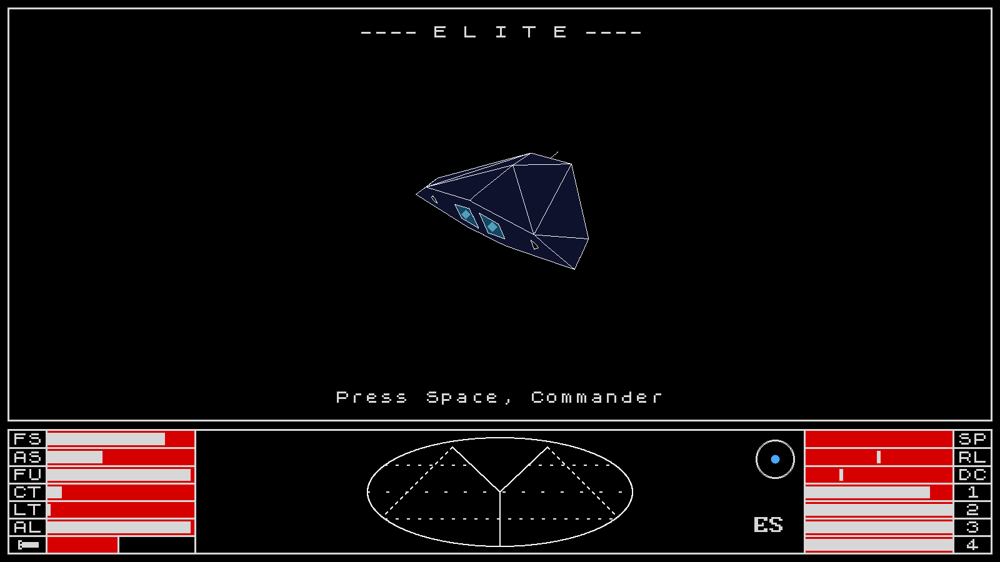
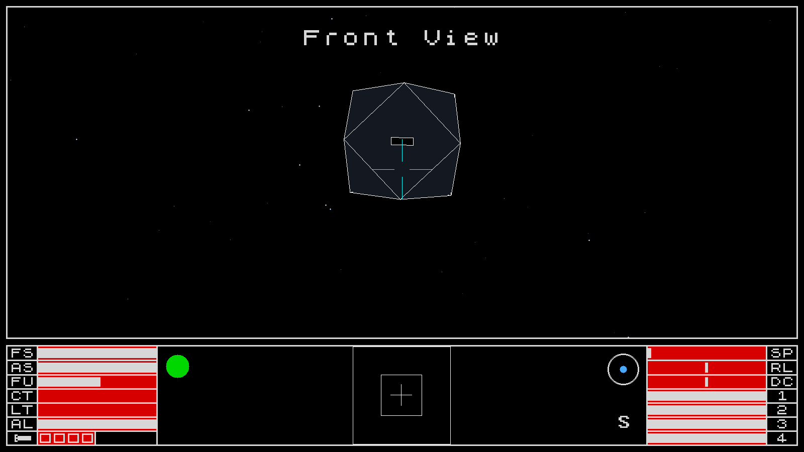
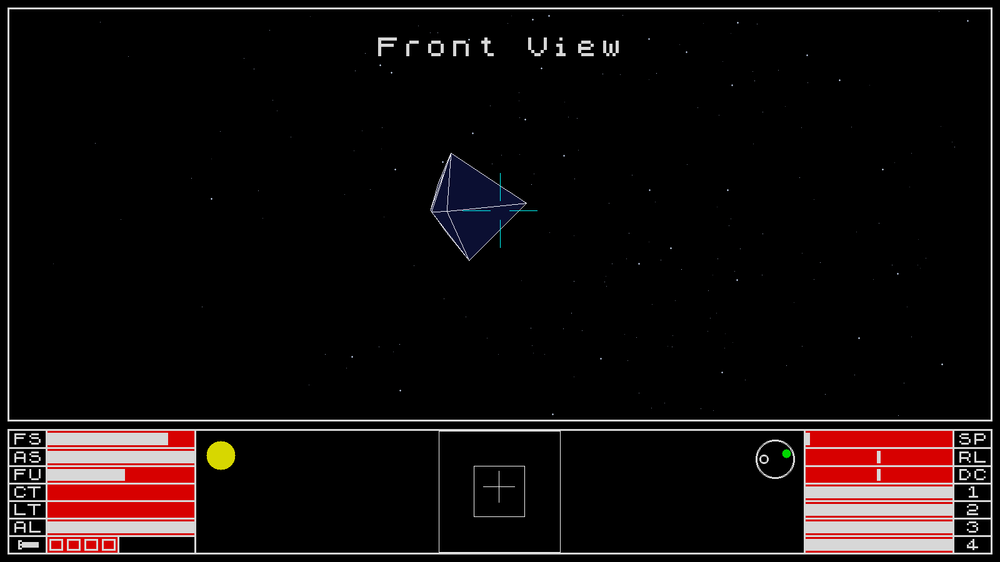

# Elite for ZX Spectrum

Это порт игры Elite для ZX Spectrum на Rust с сохранением оригинальной игровой логики и развитием графической части. Разработка ведётся на Linux, но сборка возможна на Windows и macOS.

Проект использует оригинальные игровые данные и геометрию кораблей. Начиная с версии v0.1.1-alpha в качестве звукового движка используется эмуляция General Sound.

## Демо

[](https://www.youtube.com/watch?v=4G7ZprV1oHc)

## Скриншоты

Заставка:



Нативный вид полёта — станция Кориолис:



Нативный вид полёта — корабль Python:



## Запуск

```text
usage: elite [OPTIONS] [FILE]
```

Необязательный `FILE` — файл commander-блока ровно на 102 байта. Полный список опций командной строки выводится командой
`elite --help`.

## Управление

- `Esc` — меню паузы (продолжить/сохранить/загрузить/выход).
- `F1`–`F4` — клавиши 1–4 оригинала (виды). `F1` включает нативный вид полёта
  (на станции — после вылета), `F2`–`F4` на станции пустые.
- `F5` — нативная закупка оборудования (на станции).
- `F6` — нативная карта галактики.
- `F7` — информация о выбранной планете (как `P`).
- `F9` — альтернативный экран капитана (как `L`); управление остаётся за эмулятором.
- `Enter` — нативный инвентарь: топливо и деньги.
- `F11`, `Alt+Enter` — полный экран.
- `F12` — множитель эмуляции Z80: x2 → x5 → x10 → x1; удержание дольше 1 с
  сбрасывает на x1.
- `` ` `` — выход в эмулятор из любого режима: снимает паузу, меню, редактор и
  нативные экраны; на заставке переключает титр и интро Z80.
- `Ctrl+Q` — выход из игры.

Заставка: `Space` запускает игру, `◄`/`►` переключают корабль. В меню паузы на
заставке доступна только загрузка, сохранение без игры отключено.

Карта галактики (`F6`): стрелки/`N`/`M`/`X`/`S` — курсор, `Enter` — ближайшая
планета, `+`/`-` или колесо — масштаб. Повторный `F6` и `Esc` карту не закрывают:
выход только переходом на другой экран (`F1`, `F5`, `F7`–`F9`, игровые клавиши;
`F2`–`F4` на станции пустые). `Ctrl+F1` — чит: телепорт на станцию выбранной
планеты.

Экран полёта (`F1`): управление как в оригинале — `S`/`X` или `↑`/`↓` — тангаж,
`N`/`M` или `←`/`→` — крен, `Space` — ускорение, `Shift` — торможение,
`A`/`RightCtrl` — огонь; `Esc` — меню паузы, `F1`–`F4` — виды вперёд/назад/влево/
вправо (клавиши 1–4), `1` — назад к ZX-кадру. Переходы игры (`O`, `Enter` и т.п.)
закрывают нативный вид и показывают экран оригинала.

Закупка оборудования (`F5`): клик/`Enter` — купить, `1`–`9` (+вторая цифра) —
номер товара, стрелки — выбор, `0`–`3` — крепление лазера, `Esc` — отмена
крепления.

В режиме отладки (`--debug`) справа от игры показывается полоса 256 пикселей с
кадром эмулятора 1:1. Под миниатюрой — кнопки «1 SUMMARY»/«2 HEX DUMP»:
сокращённая сводка по полям блока командира или полный дамп байтов. Стрелки на
заставке перебирают все уникальные модели из `shipdata`; название модели
показано над нижней надписью.

Экран: ZX-кадр 256×192 показывается целым множителем (чёткие квадратные
пиксели) по центру; нативные (Rust) реализации рисуют в HD-слой поверх него
в полном разрешении окна.

## Для разработчиков и ИИ-агентов

Правила работы с проектом и указатели на техническую документацию находятся в [`AGENTS.md`](AGENTS.md).
